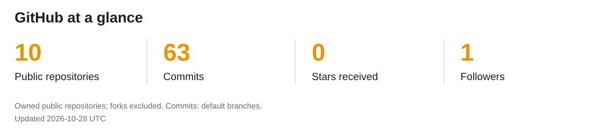
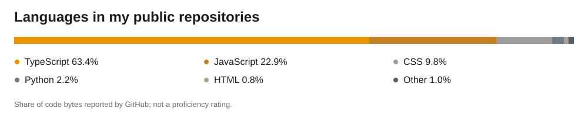

<picture>
  <source media="(prefers-color-scheme: dark)" srcset="assets/header-dark.svg?v=3">
  <source media="(prefers-color-scheme: light)" srcset="assets/header-light.svg?v=3">
  
</picture>

##  &nbsp; About

I work at the intersection of **statistical physics, particle astrophysics, and scientific computing**. I'm a Physics undergraduate at the **University of São Paulo (IFSC–USP)**, developing statistical models and computational tools to study energy sharing in cosmic-ray air showers.

My FAPESP-supported undergraduate research explores the **leading particle effect** and its connection to the **Muon Puzzle**. I build models and simulators in Python, work with CONEX/ROOT data, and use high-performance computing to compare physical hypotheses with simulations.

I also enjoy scientific animation, nonlinear dynamics, mathematics, and teaching. Around here, I'm an **APOETA**.

##  &nbsp; Research workflow

<picture>
  <source media="(prefers-color-scheme: dark) and (max-width: 600px)" srcset="assets/workflow-dark-mobile.svg">
  <source media="(max-width: 600px)" srcset="assets/workflow-light-mobile.svg">
  <source media="(prefers-color-scheme: dark)" srcset="assets/workflow-dark.svg">
  
</picture>

##  &nbsp; Selected work

<picture>
  <source media="(prefers-color-scheme: dark) and (max-width: 600px)" srcset="assets/selected-work-dark-mobile.svg">
  <source media="(max-width: 600px)" srcset="assets/selected-work-light-mobile.svg">
  <source media="(prefers-color-scheme: dark)" srcset="assets/selected-work-dark.svg">
  
</picture>

  <a href="https://github.com/davisilva169/Null-Model-of-Uniform-Fragmentation">Uniform Fragmentation</a>
  &nbsp; · &nbsp;
  <a href="https://github.com/davisilva169/Leading-Particles-and-Muon-Puzzle">Leading Particles &amp; Muon Puzzle</a>
  &nbsp; · &nbsp;
  <a href="https://github.com/davisilva169/guia-conex-apoema">CONEX / APOEMA Guide</a>
   
  <a href="https://github.com/davisilva169/Poincar-Maps">Poincaré Maps</a>
  &nbsp; · &nbsp;
  <a href="https://github.com/davisilva169/quanta-flashcards">Quanta Flashcards</a>

##  &nbsp; Research interests

`Statistical physics` · `Particle astrophysics` · `Complex systems` · `Cosmic-ray air showers` · `Monte Carlo methods` · `Nonlinear dynamics` · `Quantum mechanics` · `Markov Chain`, `Scientific visualization`

##  &nbsp; Tools

| Scientific work | Tools & methods |
| :--- | :--- |
| Modeling & analysis | **Python**, NumPy, SciPy, Pandas, Bayesian statistics, Monte Carlo |
| Air-shower simulations | **CONEX**, ROOT, CORSIKA |
| Visualization & writing | Matplotlib, Plotly, JupyterLab, LaTeX |
| Computing & reproducibility | Linux, Git, HPC, versioned notebooks |

##  &nbsp; GitHub statistics

<a href="https://github.com/davisilva169?tab=repositories">
  <picture>
    <source media="(prefers-color-scheme: dark) and (max-width: 600px)" srcset="assets/stats-dark-mobile.svg">
    <source media="(max-width: 600px)" srcset="assets/stats-light-mobile.svg">
    <source media="(prefers-color-scheme: dark)" srcset="assets/stats-dark.svg">
    
  </picture>
</a>

<picture>
  <source media="(prefers-color-scheme: dark) and (max-width: 600px)" srcset="assets/languages-dark-mobile.svg">
  <source media="(max-width: 600px)" srcset="assets/languages-light-mobile.svg">
  <source media="(prefers-color-scheme: dark)" srcset="assets/languages-dark.svg">
  
</picture>

---

  <a href="https://davisilva169.github.io/Portfolio/"><strong>Portfolio</strong></a>
  &nbsp; · &nbsp;
  <a href="mailto:davisilva169@usp.br"><strong>davisilva169@usp.br</strong></a>

