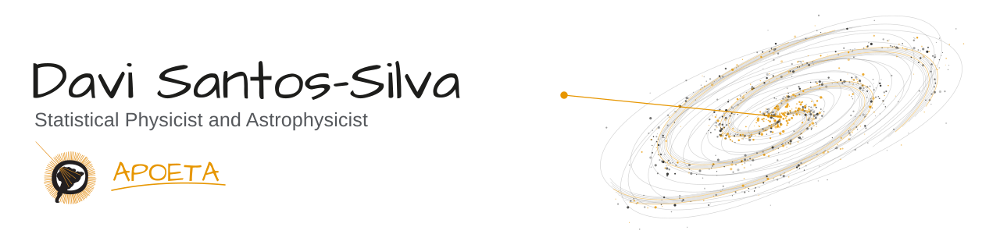
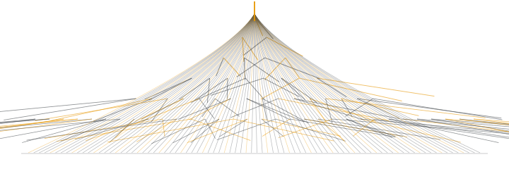
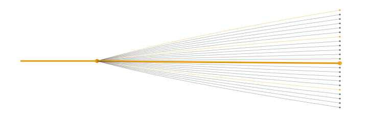

<picture>
  <source media="(prefers-color-scheme: dark)" srcset="assets/header-dark.svg">
  <source media="(prefers-color-scheme: light)" srcset="assets/header-light.svg">
  
</picture>

##  &nbsp; About

I work at the intersection of **statistical physics, particle astrophysics, and scientific computing**. I'm a Physics undergraduate at the **University of São Paulo (IFSC–USP)**, developing statistical models and computational tools to study energy sharing in cosmic-ray air showers.

My FAPESP-supported undergraduate research explores the **leading particle effect** and its connection to the **Muon Puzzle**. I build models and simulators in Python, work with CONEX/ROOT data, and use high-performance computing to compare physical hypotheses with simulations.

I also enjoy scientific animation, nonlinear dynamics, mathematics, and teaching. Around here, I'm an **APOETA**.

##  &nbsp; Research workflow

  <strong>&nbsp;Model</strong>
  &nbsp; → &nbsp;
  <strong>&nbsp;Simulate</strong>
  &nbsp; → &nbsp;
  <strong>&nbsp;Compare</strong>
  &nbsp; → &nbsp;
  <strong>&nbsp;Visualize</strong>

##  &nbsp; Selected work

<table>
  <tr>
    <td width="50%" valign="top">
      <a href="https://github.com/davisilva169/Null-Model-of-Uniform-Fragmentation">
        <picture>
          <source media="(prefers-color-scheme: dark)" srcset="assets/fragmentation-dark.svg">
          
        </picture>
      </a>
      <h3><a href="https://github.com/davisilva169/Null-Model-of-Uniform-Fragmentation">Uniform Fragmentation ↗</a></h3>
      
A uniform fragmentation null model for energy sharing in cosmic-ray cascades, used to investigate the leading particle effect through statistical tests and comparisons with simulations.

      
<code>Python</code> <code>Monte Carlo</code> <code>Statistical modeling</code>

    </td>
    <td width="50%" valign="top">
      <a href="https://github.com/davisilva169/Leading-Particles-and-Muon-Puzzle">
        <picture>
          <source media="(prefers-color-scheme: dark)" srcset="assets/leading-particles-dark.svg">
          
        </picture>
      </a>
      <h3><a href="https://github.com/davisilva169/Leading-Particles-and-Muon-Puzzle">Leading Particles &amp; Muon Puzzle ↗</a></h3>
      
Research on leading particles in high-energy cosmic-ray interactions and their relationship to air-shower development and muon production.

      
<code>Particle astrophysics</code> <code>CONEX</code> <code>ROOT</code>

    </td>
  </tr>
</table>

Also exploring: [Poincaré maps and the Duffing oscillator](https://github.com/davisilva169/Poincar-Maps), nonlinear dynamics, and scientific visualization.

##  &nbsp; Research interests

`Statistical physics` · `Particle astrophysics` · `Complex systems` · `Cosmic-ray air showers` · `Monte Carlo methods` · `Nonlinear dynamics` · `Quantum mechanics` · `Scientific visualization`

##  &nbsp; Tools

| Scientific work | Tools & methods |
| :--- | :--- |
| Modeling & analysis | **Python**, NumPy, SciPy, Pandas, Bayesian statistics, Monte Carlo |
| Air-shower simulations | **CONEX**, ROOT, CORSIKA |
| Visualization & writing | Matplotlib, Plotly, JupyterLab, LaTeX |
| Computing & reproducibility | Linux, Git, HPC, versioned notebooks |

##  &nbsp; GitHub statistics

<a href="https://github.com/davisilva169?tab=repositories">
  <picture>
    <source media="(prefers-color-scheme: dark) and (max-width: 600px)" srcset="assets/stats-dark-mobile.svg">
    <source media="(max-width: 600px)" srcset="assets/stats-light-mobile.svg">
    <source media="(prefers-color-scheme: dark)" srcset="assets/stats-dark.svg">
    
  </picture>
</a>

<picture>
  <source media="(prefers-color-scheme: dark) and (max-width: 600px)" srcset="assets/languages-dark-mobile.svg">
  <source media="(max-width: 600px)" srcset="assets/languages-light-mobile.svg">
  <source media="(prefers-color-scheme: dark)" srcset="assets/languages-dark.svg">
  
</picture>

---

  <a href="https://davisilva169.github.io/Portfolio/"><strong>Portfolio ↗</strong></a>
  &nbsp; · &nbsp;
  <a href="mailto:davisilva169@usp.br"><strong>davisilva169@usp.br</strong></a>

